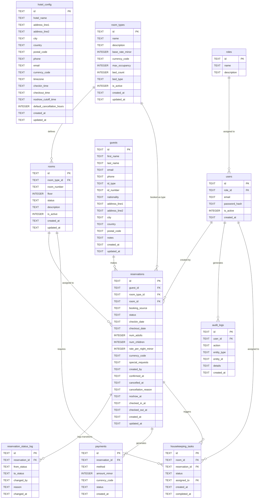

# Hotel Management System — Database Design Document

**Document Version:** 1.0  
**Status:** Draft — Awaiting Owner Review and Approval  
**Prepared for:** Hotel Management System, Phase: Database Design  
**Architecture Baseline:** Hotel Blueprint v1.3  
**Date:** 2026-11-14

---

## Table of Contents

1. [Executive Summary](#1-executive-summary)
2. [Architecture Compliance](#2-architecture-compliance)
3. [Entity Relationship Diagram](#3-entity-relationship-diagram)
4. [Table-by-Table Data Dictionary](#4-table-by-table-data-dictionary)
5. [Primary Keys and Relationships](#5-primary-keys-and-relationships)
6. [Reservation Lifecycle](#6-reservation-lifecycle)
7. [Room Availability and Double-Booking Prevention](#7-room-availability-and-double-booking-prevention)
8. [Date and Time Handling](#8-date-and-time-handling)
9. [Security and Data Privacy](#9-security-and-data-privacy)
10. [Migration Strategy](#10-migration-strategy)
11. [Seed and Reference Data](#11-seed-and-reference-data)
12. [Testing Requirements](#12-testing-requirements)
13. [Implementation Roadmap](#13-implementation-roadmap)
14. [Assumptions and Unresolved Decisions](#14-assumptions-and-unresolved-decisions)

---

## 1. Executive Summary

This document describes the proposed database architecture for the Hotel Management System. The system is designed as a reusable, independently deployable application. Each hotel operates its own application instance with its own isolated Cloudflare D1 database. No data is shared between hotel instances.

The database engine is Cloudflare D1, which is a serverless SQLite-compatible database hosted at the Cloudflare edge. The backend API is a Cloudflare Worker written in TypeScript. The database design is therefore constrained to SQLite-compatible types, syntax, and transaction semantics.

The foundational schema covers hotel configuration, room types, rooms, guests, and reservations. This core is designed to be immediately useful and to support all foreseeable Phase B modules — reception, check-in, check-out, payments, housekeeping, accounting, users, roles, audit logs, reports, notifications, and guest history — without requiring a major structural redesign.

The proposed design is minimal, pragmatic, and appropriate for a small hotel operating on a modest budget. It avoids unnecessary complexity while providing a stable foundation for future growth.

---

## 2. Architecture Compliance

### 2.1 Independent-Hotel Deployment Architecture

This design fully complies with the approved architecture:

- One reusable application codebase.
- Each hotel instance is independently deployed to Cloudflare Workers.
- Each hotel instance is bound to its own independent Cloudflare D1 database.
- No hotel shares database resources with any other hotel.
- Configuration specific to a hotel is stored in that hotel's own `hotel_config` table, not in environment-level shared configuration.

### 2.2 Why This Design Does Not Use Shared-Database Multi-Tenancy

A shared-database, multi-tenant architecture (commonly implemented via a `tenant_id` column on every table) was explicitly rejected by the project owner and is not used here.

The reasons this design avoids that approach are:

1. **Data isolation.** Each hotel's data is completely isolated at the database level. There is no risk of a query accidentally returning data belonging to another hotel.
2. **Security.** A programming error cannot leak one hotel's reservation or guest data to another hotel's users. Isolation is enforced by infrastructure, not by application-level filters.
3. **Simplicity.** The schema, queries, and application code are simpler. No query requires a `WHERE tenant_id = ?` clause. No index needs to include `tenant_id`.
4. **Independent scaling.** Each hotel's database can be managed, backed up, migrated, or scaled independently.
5. **Reusability.** The same application code and schema is reused for every hotel deployment. Each hotel deploys its own instance and configures it through its own `hotel_config` table.
6. **D1 cost model.** Cloudflare D1 charges per database, not per row. Having separate databases per hotel is consistent with the D1 billing model at small scale.

No `tenant_id` column appears in any table in this design.

---

## 3. Entity Relationship Diagram

The following Mermaid ER diagram represents the foundational Phase A entities and their relationships. Future module entities are shown as stubs to illustrate planned extension points.



---

## 4. Table-by-Table Data Dictionary

### 4.1 `hotel_config`

**Purpose:** Stores the operational configuration for this hotel instance. There is exactly one row in this table per deployment. This table replaces environment-variable-only configuration for data that must be queried, modified at runtime, or audited.

| Column | Type | PK | FK | Nullable | Default | Constraints | Description |
|---|---|---|---|---|---|---|---|
| `id` | `TEXT` | Yes | — | No | `'hotel'` | `CHECK (id = 'hotel')` | Singleton row guard. The only valid value is `'hotel'`. |
| `hotel_name` | `TEXT` | No | — | No | — | `NOT NULL` | Full legal name of the hotel. |
| `address_line1` | `TEXT` | No | — | No | — | `NOT NULL` | Primary street address. |
| `address_line2` | `TEXT` | No | — | Yes | `NULL` | — | Suite, floor, or additional address information. |
| `city` | `TEXT` | No | — | No | — | `NOT NULL` | City. |
| `country` | `TEXT` | No | — | No | — | `NOT NULL` | ISO 3166-1 alpha-2 country code (e.g. `'TH'`). |
| `postal_code` | `TEXT` | No | — | Yes | `NULL` | — | Postal or ZIP code. |
| `phone` | `TEXT` | No | — | Yes | `NULL` | — | Hotel contact telephone number. |
| `email` | `TEXT` | No | — | Yes | `NULL` | — | Hotel contact email address. |
| `currency_code` | `TEXT` | No | — | No | `'THB'` | `NOT NULL` | ISO 4217 currency code for billing. |
| `timezone` | `TEXT` | No | — | No | `'Asia/Bangkok'` | `NOT NULL` | IANA timezone identifier (e.g. `'Asia/Bangkok'`). Used for all local time calculations. |
| `checkin_time` | `TEXT` | No | — | No | `'14:00'` | `NOT NULL`, `CHECK` | Standard check-in time in `HH:MM` 24-hour format. Approved default: `14:00`. |
| `checkout_time` | `TEXT` | No | — | No | `'12:00'` | `NOT NULL`, `CHECK` | Standard check-out time in `HH:MM` 24-hour format. Approved default: `12:00`. |
| `noshow_cutoff_time` | `TEXT` | No | — | No | `'23:00'` | `NOT NULL`, `CHECK` | Time after which an unconfirmed arriving reservation may be marked no-show. Approved default: `23:00`. |
| `default_cancellation_hours` | `INTEGER` | No | — | No | `24` | `NOT NULL`, `CHECK (> 0)` | Hours before check-in within which cancellation may be penalised. **Requires owner approval for exact policy.** |
| `created_at` | `TEXT` | No | — | No | `(datetime('now'))` | `NOT NULL` | ISO 8601 UTC timestamp of record creation. |
| `updated_at` | `TEXT` | No | — | No | `(datetime('now'))` | `NOT NULL` | ISO 8601 UTC timestamp of last update. Maintained by application layer. |

**Singleton constraint:** `CHECK (id = 'hotel')` combined with the primary key ensures that only one configuration row can ever exist.

---

### 4.2 `room_types`

**Purpose:** Defines the categories of rooms the hotel offers (e.g. Standard, Deluxe, Suite). Room types drive pricing and booking availability at the category level before a specific room is assigned.

| Column | Type | PK | FK | Nullable | Default | Constraints | Description |
|---|---|---|---|---|---|---|---|
| `id` | `TEXT` | Yes | — | No | — | `NOT NULL` | UUID v4 string identifier. |
| `name` | `TEXT` | No | — | No | — | `NOT NULL`, `UNIQUE` | Display name of the room type (e.g. `'Deluxe Double'`). |
| `description` | `TEXT` | No | — | Yes | `NULL` | — | Long-form description shown to guests during booking. |
| `base_rate_minor` | `INTEGER` | No | — | No | — | `NOT NULL`, `CHECK (>= 0)` | Base nightly rate in the smallest currency unit (e.g. satang for THB). Stored as integer to avoid floating-point errors. |
| `currency_code` | `TEXT` | No | — | No | — | `NOT NULL` | ISO 4217 currency code. Should match `hotel_config.currency_code`. |
| `max_occupancy` | `INTEGER` | No | — | No | — | `NOT NULL`, `CHECK (>= 1)` | Maximum number of guests permitted in this room type. |
| `bed_count` | `INTEGER` | No | — | No | — | `NOT NULL`, `CHECK (>= 1)` | Number of beds. |
| `bed_type` | `TEXT` | No | — | Yes | `NULL` | — | Bed configuration (e.g. `'King'`, `'Twin'`, `'Double'`). |
| `is_active` | `INTEGER` | No | — | No | `1` | `NOT NULL`, `CHECK (IN (0,1))` | Boolean flag. `1` = available for booking; `0` = disabled. SQLite boolean represented as integer. |
| `created_at` | `TEXT` | No | — | No | `(datetime('now'))` | `NOT NULL` | ISO 8601 UTC creation timestamp. |
| `updated_at` | `TEXT` | No | — | No | `(datetime('now'))` | `NOT NULL` | ISO 8601 UTC last-updated timestamp. |

---

### 4.3 `rooms`

**Purpose:** Represents a physical room within the hotel. Each room belongs to a room type and has a current operational status. Reservations may be initially booked against a room type and later assigned to a specific room.

| Column | Type | PK | FK | Nullable | Default | Constraints | Description |
|---|---|---|---|---|---|---|---|
| `id` | `TEXT` | Yes | — | No | — | `NOT NULL` | UUID v4 string identifier. |
| `room_type_id` | `TEXT` | No | `room_types.id` | No | — | `NOT NULL`, `REFERENCES room_types(id)` | The room type this room belongs to. |
| `room_number` | `TEXT` | No | — | No | — | `NOT NULL`, `UNIQUE` | Human-readable room identifier (e.g. `'101'`, `'301A'`). Must be unique across the hotel. |
| `floor` | `INTEGER` | No | — | Yes | `NULL` | — | Floor level. Useful for housekeeping assignment and guest preferences. |
| `status` | `TEXT` | No | — | No | `'available'` | `NOT NULL`, `CHECK (IN ('available','occupied','cleaning','maintenance','out_of_order'))` | Current operational status of the room. |
| `description` | `TEXT` | No | — | Yes | `NULL` | — | Notes about the specific room (e.g. corner room, partial sea view). |
| `is_active` | `INTEGER` | No | — | No | `1` | `NOT NULL`, `CHECK (IN (0,1))` | `1` = room is in service; `0` = room is permanently removed from inventory. |
| `created_at` | `TEXT` | No | — | No | `(datetime('now'))` | `NOT NULL` | ISO 8601 UTC creation timestamp. |
| `updated_at` | `TEXT` | No | — | No | `(datetime('now'))` | `NOT NULL` | ISO 8601 UTC last-updated timestamp. |

**Room status values:**

| Status | Meaning |
|---|---|
| `available` | Room is clean, inspected, and ready for check-in. |
| `occupied` | A guest is currently checked in. |
| `cleaning` | Room requires or is undergoing housekeeping. |
| `maintenance` | Room is under maintenance and not bookable. |
| `out_of_order` | Room is permanently or long-term unavailable. |

---

### 4.4 `guests`

**Purpose:** Stores the personal profile of each guest. A guest may have multiple reservations over time. Guest records persist across reservations to support guest history and loyalty features in future phases.

| Column | Type | PK | FK | Nullable | Default | Constraints | Description |
|---|---|---|---|---|---|---|---|
| `id` | `TEXT` | Yes | — | No | — | `NOT NULL` | UUID v4 string identifier. |
| `first_name` | `TEXT` | No | — | No | — | `NOT NULL` | Guest's first (given) name. |
| `last_name` | `TEXT` | No | — | No | — | `NOT NULL` | Guest's last (family) name. |
| `email` | `TEXT` | No | — | Yes | `NULL` | `UNIQUE` | Email address. Nullable to support walk-in guests without email. If provided, must be unique. |
| `phone` | `TEXT` | No | — | Yes | `NULL` | — | Contact telephone number, including country code if available. |
| `id_type` | `TEXT` | No | — | Yes | `NULL` | `CHECK (IN ('passport','national_id','drivers_license','other',NULL))` | Type of government-issued identification. |
| `id_number` | `TEXT` | No | — | Yes | `NULL` | — | Government-issued identification number. Sensitive; see Section 9. |
| `nationality` | `TEXT` | No | — | Yes | `NULL` | — | ISO 3166-1 alpha-2 country code of the guest's nationality. |
| `address_line1` | `TEXT` | No | — | Yes | `NULL` | — | Guest's home address line 1. |
| `address_line2` | `TEXT` | No | — | Yes | `NULL` | — | Guest's home address line 2. |
| `city` | `TEXT` | No | — | Yes | `NULL` | — | Guest's city. |
| `country` | `TEXT` | No | — | Yes | `NULL` | — | Guest's country (ISO 3166-1 alpha-2). |
| `postal_code` | `TEXT` | No | — | Yes | `NULL` | — | Guest's postal code. |
| `notes` | `TEXT` | No | — | Yes | `NULL` | — | Internal staff notes about the guest (e.g. preferences, accessibility requirements). |
| `created_at` | `TEXT` | No | — | No | `(datetime('now'))` | `NOT NULL` | ISO 8601 UTC creation timestamp. |
| `updated_at` | `TEXT` | No | — | No | `(datetime('now'))` | `NOT NULL` | ISO 8601 UTC last-updated timestamp. |

**Deduplication note:** Guest deduplication (merging duplicate guest records) is deferred to a future phase. For now, the email uniqueness constraint provides a basic guard. See Section 14 for the unresolved question about walk-in guest handling.

---

### 4.5 `reservations`

**Purpose:** The central entity of the system. Records every booking, whether made by a guest online or created by staff at reception. Tracks the full lifecycle from creation through check-out.

| Column | Type | PK | FK | Nullable | Default | Constraints | Description |
|---|---|---|---|---|---|---|---|
| `id` | `TEXT` | Yes | — | No | — | `NOT NULL` | UUID v4 string identifier. |
| `guest_id` | `TEXT` | No | `guests.id` | No | — | `NOT NULL`, `REFERENCES guests(id)` | The guest this reservation belongs to. |
| `room_type_id` | `TEXT` | No | `room_types.id` | No | — | `NOT NULL`, `REFERENCES room_types(id)` | The room type booked. Set at reservation creation and may differ from the assigned room's type if the guest is upgraded. |
| `room_id` | `TEXT` | No | `rooms.id` | Yes | `NULL` | `REFERENCES rooms(id)` | The specific room assigned. Nullable: a reservation may exist without a specific room assignment until check-in. |
| `booking_source` | `TEXT` | No | — | No | — | `NOT NULL`, `CHECK (IN ('online','reception','phone','email','ota','other'))` | How the reservation was created. |
| `status` | `TEXT` | No | — | No | `'pending'` | `NOT NULL`, `CHECK (IN ('pending','confirmed','checked_in','checked_out','cancelled','no_show'))` | Current lifecycle status. See Section 6. |
| `checkin_date` | `TEXT` | No | — | No | — | `NOT NULL` | Intended check-in date in `YYYY-MM-DD` format. |
| `checkout_date` | `TEXT` | No | — | No | — | `NOT NULL`, `CHECK (checkout_date > checkin_date)` | Intended check-out date in `YYYY-MM-DD` format. Must be after check-in date. |
| `num_adults` | `INTEGER` | No | — | No | `1` | `NOT NULL`, `CHECK (>= 1)` | Number of adult guests. |
| `num_children` | `INTEGER` | No | — | No | `0` | `NOT NULL`, `CHECK (>= 0)` | Number of child guests. |
| `rate_per_night_minor` | `INTEGER` | No | — | No | — | `NOT NULL`, `CHECK (>= 0)` | Agreed nightly rate in smallest currency unit at time of booking. Locked at booking time and does not change if the room type rate changes later. |
| `currency_code` | `TEXT` | No | — | No | — | `NOT NULL` | Currency code for this reservation. |
| `special_requests` | `TEXT` | No | — | Yes | `NULL` | — | Guest's special requests (e.g. high floor, extra pillows). |
| `created_by` | `TEXT` | No | — | Yes | `NULL` | — | User ID of the staff member who created the reservation, if created internally. `NULL` for online guest bookings. |
| `confirmed_at` | `TEXT` | No | — | Yes | `NULL` | — | ISO 8601 UTC timestamp when the reservation was confirmed. |
| `cancelled_at` | `TEXT` | No | — | Yes | `NULL` | — | ISO 8601 UTC timestamp when the reservation was cancelled. |
| `cancellation_reason` | `TEXT` | No | — | Yes | `NULL` | — | Free-text cancellation reason. |
| `noshow_at` | `TEXT` | No | — | Yes | `NULL` | — | ISO 8601 UTC timestamp when the reservation was marked no-show. |
| `checked_in_at` | `TEXT` | No | — | Yes | `NULL` | — | ISO 8601 UTC timestamp of actual check-in. |
| `checked_out_at` | `TEXT` | No | — | Yes | `NULL` | — | ISO 8601 UTC timestamp of actual check-out. |
| `created_at` | `TEXT` | No | — | No | `(datetime('now'))` | `NOT NULL` | ISO 8601 UTC reservation creation timestamp. |
| `updated_at` | `TEXT` | No | — | No | `(datetime('now'))` | `NOT NULL` | ISO 8601 UTC last-updated timestamp. |

**Rate locking:** `rate_per_night_minor` is captured at booking time and never automatically updated. This ensures that changes to room type pricing do not retroactively affect existing reservations.

---

### 4.6 `reservation_status_log`

**Purpose:** Provides a complete, immutable audit trail of every status transition for every reservation. This table is essential for dispute resolution, reporting, and compliance.

| Column | Type | PK | FK | Nullable | Default | Constraints | Description |
|---|---|---|---|---|---|---|---|
| `id` | `TEXT` | Yes | — | No | — | `NOT NULL` | UUID v4 string identifier. |
| `reservation_id` | `TEXT` | No | `reservations.id` | No | — | `NOT NULL`, `REFERENCES reservations(id)` | The reservation that changed status. |
| `from_status` | `TEXT` | No | — | Yes | `NULL` | — | The status before the transition. `NULL` for initial creation. |
| `to_status` | `TEXT` | No | — | No | — | `NOT NULL` | The status after the transition. |
| `changed_by` | `TEXT` | No | — | Yes | `NULL` | — | User ID of the actor who made the change. `NULL` for automated or guest-initiated transitions. |
| `reason` | `TEXT` | No | — | Yes | `NULL` | — | Optional reason or note for the transition. |
| `changed_at` | `TEXT` | No | — | No | `(datetime('now'))` | `NOT NULL` | ISO 8601 UTC timestamp of the transition. |

---

### 4.7 Phase B Stub Tables (Future Modules)

The following tables are planned but not fully designed in this phase. Their existence is documented here to confirm that the foundational design accommodates them.

#### 4.7.1 `users`

Stores staff user accounts. Linked to reservations via `reservations.created_by` and to audit logs via `audit_logs.user_id`. See Section 9 for password storage requirements.

#### 4.7.2 `roles`

Defines staff roles (e.g. Admin, Receptionist, Housekeeper, Accountant). Linked to users via `users.role_id`.

#### 4.7.3 `role_permissions`

Maps roles to specific permission codes. Enables fine-grained access control without hardcoding roles in application logic.

#### 4.7.4 `payments`

Records payment transactions linked to reservations. Stores amount in minor currency units. Does not store raw card numbers. See Section 9.

#### 4.7.5 `invoices`

Links multiple payment transactions to a consolidated billing record for a reservation.

#### 4.7.6 `housekeeping_tasks`

Tracks room cleaning assignments linked to rooms, reservations, and assigned staff users. Status values include `pending`, `in_progress`, `completed`, `inspected`.

#### 4.7.7 `audit_logs`

Immutable log of all significant application actions. Linked to users. Stores entity type, entity ID, and a JSON-serialised details blob.

#### 4.7.8 `notifications`

Outbound notification records (email, SMS, etc.) linked to reservations and guests. Stores template used, delivery status, and timestamp.

#### 4.7.9 `guest_history`

Aggregated or denormalised view of a guest's stay history. May be a view over `reservations` or a materialised summary table, to be decided in Phase B.

---

## 5. Primary Keys and Relationships

### 5.1 Primary Key Strategy

All tables use `TEXT` primary keys containing UUID v4 values generated by the application layer before insertion. This strategy is chosen because:

- UUID v4 values are globally unique without coordination, which is valuable when records may eventually be synchronised, exported, or referenced externally.
- Application-generated IDs are available immediately in the application before the database write completes, simplifying API response design.
- SQLite's `ROWID`-based auto-increment (`INTEGER PRIMARY KEY`) is a valid alternative but creates sequential, guessable IDs that are less suitable for guest-facing references.
- Cloudflare D1 does not support sequences, so application-generated UUIDs are the natural choice.

**UUID generation:** The application will use the `crypto.randomUUID()` Web API, which is available in Cloudflare Workers without additional dependencies.

### 5.2 Foreign Key Enforcement

SQLite foreign key enforcement is **disabled by default** and must be explicitly enabled per connection with:

```sql
PRAGMA foreign_keys = ON;
```

The Worker application must issue this PRAGMA at the start of every D1 database session. This is a critical application-layer requirement.

> **Note for implementation agent:** Cloudflare D1 does not automatically run `PRAGMA foreign_keys = ON`. This must be called explicitly in the Worker code before any DML operations.

### 5.3 Foreign Key Relationships

| Child Table | Child Column | Parent Table | Parent Column | On Delete | On Update |
|---|---|---|---|---|---|
| `rooms` | `room_type_id` | `room_types` | `id` | `RESTRICT` | `CASCADE` |
| `reservations` | `guest_id` | `guests` | `id` | `RESTRICT` | `CASCADE` |
| `reservations` | `room_type_id` | `room_types` | `id` | `RESTRICT` | `CASCADE` |
| `reservations` | `room_id` | `rooms` | `id` | `RESTRICT` | `CASCADE` |
| `reservation_status_log` | `reservation_id` | `reservations` | `id` | `CASCADE` | `CASCADE` |

**On Delete RESTRICT** is used for all business entities (guests, rooms, room types, reservations) to prevent accidental data loss. Historical records must not be silently deleted. Soft deletion via `is_active` flags is preferred.

**On Delete CASCADE** is used only for `reservation_status_log` entries, as they have no independent meaning without their parent reservation.

### 5.4 Unique Constraints

| Table | Column(s) | Reason |
|---|---|---|
| `hotel_config` | `id` (PK + CHECK) | Singleton row enforcement. |
| `room_types` | `name` | Room type names must be distinct. |
| `rooms` | `room_number` | Room numbers must be unique across the hotel. |
| `guests` | `email` | Prevents duplicate guest profiles when email is provided. |

### 5.5 Indexing Strategy

The following indexes are recommended for query performance:

```sql
-- Reservation queries by guest
CREATE INDEX idx_reservations_guest_id ON reservations (guest_id);

-- Reservation queries by room
CREATE INDEX idx_reservations_room_id ON reservations (room_id);

-- Reservation queries by room type
CREATE INDEX idx_reservations_room_type_id ON reservations (room_type_id);

-- Availability queries by date range
CREATE INDEX idx_reservations_dates ON reservations (checkin_date, checkout_date);

-- Reservation queries by status
CREATE INDEX idx_reservations_status ON reservations (status);

-- Status log queries by reservation
CREATE INDEX idx_reservation_status_log_reservation_id ON reservation_status_log (reservation_id);

-- Room queries by type
CREATE INDEX idx_rooms_room_type_id ON rooms (room_type_id);

-- Room queries by status
CREATE INDEX idx_rooms_status ON rooms (status);
```

At the scale of a small hotel (typically fewer than 200 rooms), these indexes are sufficient. Additional composite indexes may be added as query patterns are identified during development.

---

## 6. Reservation Lifecycle

### 6.1 Reservation Statuses

| Status | Meaning |
|---|---|
| `pending` | Reservation has been created but not yet confirmed. Payment or manual confirmation may be required. |
| `confirmed` | Reservation is confirmed. The hotel expects the guest to arrive. |
| `checked_in` | The guest has physically arrived and been checked in. A specific room has been assigned. |
| `checked_out` | The guest has vacated the room. The stay is complete. |
| `cancelled` | The reservation has been cancelled before check-in. |
| `no_show` | The guest did not arrive by the no-show cutoff time and the reservation was marked no-show. |

### 6.2 Status Transition Matrix

```
pending → confirmed        (staff confirms, or automatic on payment)
pending → cancelled        (guest or staff cancels)

confirmed → checked_in     (staff checks in the guest at reception)
confirmed → cancelled      (guest or staff cancels before arrival)
confirmed → no_show        (staff marks no-show after cutoff time)

checked_in → checked_out   (staff checks out the guest at reception)

cancelled → (terminal)
no_show → (terminal)
checked_out → (terminal)
```

The following transitions are **explicitly prohibited:**

- `checked_in → cancelled` — A guest who has checked in cannot be cancelled. The stay must be ended via check-out.
- `checked_out → any` — Check-out is a terminal state.
- `cancelled → any` — Cancellation is a terminal state. A new reservation must be created if the guest re-books.
- `no_show → checked_in` — **[PROPOSED — requires owner approval]** A no-show guest who arrives after cutoff time cannot be automatically reinstated. A new reservation or a staff override should be required.

### 6.3 Booking Sources

| Source | Meaning |
|---|---|
| `online` | Guest booked through the public web booking interface. |
| `reception` | Staff created the reservation at the front desk. |
| `phone` | Staff created the reservation on behalf of a guest calling by phone. |
| `email` | Staff created the reservation based on a guest email request. |
| `ota` | Reservation originated from an Online Travel Agency (e.g. Booking.com, Agoda). Manual import or future OTA integration. |
| `other` | Any other source. |

### 6.4 Reservation Creation

Both public guest bookings and internal reception bookings create a row in the `reservations` table. The difference is:

- **Online guest booking:** `booking_source = 'online'`, `created_by = NULL`. Initial status is `pending` until payment or manual confirmation.
- **Reception booking:** `booking_source = 'reception'` (or `phone`/`email`), `created_by = <user_id>`. Initial status may be `confirmed` immediately at staff discretion. **[PROPOSED — requires owner approval: whether reception bookings start as `pending` or `confirmed`.]**

A reservation may be created at the room-type level (`room_id = NULL`) without assigning a specific room. A specific room must be assigned before or at check-in.

### 6.5 Reservation Modification

Modifications to dates, room type, or guest count on a `pending` or `confirmed` reservation are allowed. The business rules for modifications after partial payment are deferred to Phase B.

Every modification that changes the reservation status must create a row in `reservation_status_log`.

Modifications to `checked_in` reservations (e.g. extending a stay) are deferred to Phase B reception operations.

### 6.6 Cancellation

Cancellation is allowed from `pending` or `confirmed` status. The application must:

1. Set `reservations.status = 'cancelled'`.
2. Set `reservations.cancelled_at` to the current UTC timestamp.
3. Set `reservations.cancellation_reason` if provided.
4. Insert a row into `reservation_status_log`.
5. If a room was assigned, trigger a housekeeping task (Phase B).

Cancellation penalty rules (fees, refund policy) are deferred to the payments module in Phase B. **[REQUIRES OWNER APPROVAL: cancellation fee policy.]**

### 6.7 No-Show Handling

After the approved no-show cutoff time (`23:00` local hotel time, from `hotel_config.noshow_cutoff_time`), a `confirmed` reservation for today's date may be marked as `no_show` by staff.

The application must:

1. Verify the current local hotel time is past `hotel_config.noshow_cutoff_time`.
2. Verify the reservation's `checkin_date` is today.
3. Verify the reservation status is `confirmed`.
4. Set `reservations.status = 'no_show'`.
5. Set `reservations.noshow_at` to the current UTC timestamp.
6. Insert a row into `reservation_status_log`.

Automated no-show marking (via a scheduled Worker) is a **[PROPOSED — requires owner approval]** future feature.

### 6.8 Check-In

Check-in is performed by reception staff. Before check-in:

1. The reservation must be in `confirmed` status.
2. A specific room must be assigned (`reservations.room_id` must not be `NULL`).
3. The assigned room's `status` must be `'available'` (cleaned and ready). **[Approved rule: same-day turnover allowed only after room is marked ready.]**
4. The guest's identity may be verified against `guests.id_type` and `guests.id_number`.

On check-in:

1. Set `reservations.status = 'checked_in'`.
2. Set `reservations.checked_in_at` to the current UTC timestamp.
3. Set `rooms.status = 'occupied'`.
4. Insert a row into `reservation_status_log`.

### 6.9 Check-Out

Check-out is performed by reception staff.

1. The reservation must be in `checked_in` status.
2. Set `reservations.status = 'checked_out'`.
3. Set `reservations.checked_out_at` to the current UTC timestamp.
4. Set `rooms.status = 'cleaning'` (not `'available'` — room must be cleaned before next check-in).
5. Create a housekeeping task for the room (Phase B).
6. Insert a row into `reservation_status_log`.
7. Generate a final invoice (Phase B).

---

## 7. Room Availability and Double-Booking Prevention

### 7.1 Two Levels of Booking

The system distinguishes between two levels of booking:

1. **Room-type booking:** A reservation is created for a room type (`room_type_id`) without a specific room assigned (`room_id = NULL`). This is the typical initial state for online and phone bookings.
2. **Specific-room assignment:** A specific room (`room_id`) is assigned to the reservation, either at booking time (if reception creates it) or at check-in.

### 7.2 Room-Type Availability Check

Before accepting a new reservation for a room type, the application must verify that at least one room of that type will be available for the requested date range. The query is:

```sql
-- Count of rooms of the requested type
SELECT COUNT(*) AS total_rooms
FROM rooms
WHERE room_type_id = ? AND is_active = 1;

-- Count of active reservations for the type that overlap the requested range
SELECT COUNT(*) AS conflicting_reservations
FROM reservations
WHERE room_type_id = ?
  AND status IN ('pending', 'confirmed', 'checked_in')
  AND checkin_date < ?   -- requested checkout_date
  AND checkout_date > ?; -- requested checkin_date
```

If `conflicting_reservations >= total_rooms`, the room type is fully booked and the new reservation must be rejected.

This check must be performed within a D1 transaction to prevent race conditions under concurrent booking.

### 7.3 Specific-Room Double-Booking Prevention

When assigning a specific room to a reservation, the application must verify no overlapping reservation exists:

```sql
SELECT COUNT(*) AS conflicts
FROM reservations
WHERE room_id = ?
  AND status IN ('confirmed', 'checked_in')
  AND id != ?              -- exclude the reservation being updated
  AND checkin_date < ?     -- requested checkout_date
  AND checkout_date > ?;   -- requested checkin_date
```

If `conflicts > 0`, the room assignment must be rejected.

### 7.4 Overlap Detection Logic

Two date ranges `[A_in, A_out)` and `[B_in, B_out)` overlap if and only if:

```
A_in < B_out AND A_out > B_in
```

This is the standard half-open interval overlap test. The check-in date is inclusive and the check-out date is exclusive (a guest checking out on day D does not occupy the room on day D for a new arrival).

**This means a guest checking out on 2027-03-15 and a guest checking in on 2027-03-15 do NOT conflict**, provided the room has been cleaned and marked `available` before the second guest checks in. This is consistent with the approved same-day turnover rule.

### 7.5 Room Readiness Check

A room may not be assigned or checked in to unless `rooms.status = 'available'`. This prevents:

- Assigning a room that is currently occupied.
- Checking in a guest to a room that is in `cleaning` or `maintenance` status.
- Same-day turnover before housekeeping has completed and marked the room ready.

### 7.6 SQLite/D1 Limitations and Mitigations

SQLite does not support multi-statement constraints or deferred triggers that could enforce double-booking prevention at the database level. Mitigations:

1. **Application-layer transaction:** All availability checks and reservation inserts/updates are wrapped in a single D1 transaction. D1 supports serialisable transactions.
2. **Serialised writes:** The Worker handles one D1 write operation at a time per transaction. Under Cloudflare's execution model, concurrent requests to the same D1 database are serialised by D1's transactional guarantees.
3. **Idempotency:** Each reservation creation is guarded by an application-generated UUID, preventing duplicate submissions.

> **Known limitation:** D1 does not support `CHECK` constraints that perform sub-queries (e.g. a constraint that queries `reservations` to prevent overlap). All double-booking prevention logic is enforced in the application layer, not the database layer. The implementation agent must ensure this logic is never bypassed.

---

## 8. Date and Time Handling

### 8.1 Storage Formats

| Data type | Storage format | Example |
|---|---|---|
| Date | `TEXT` as `YYYY-MM-DD` | `'2027-03-15'` |
| Time | `TEXT` as `HH:MM` | `'14:00'` |
| Timestamp | `TEXT` as ISO 8601 UTC | `'2027-03-15T06:30:00Z'` |

All timestamps are stored in UTC. Local times are computed by the application using the hotel's IANA timezone (`hotel_config.timezone`).

SQLite's `datetime()` function returns UTC when called with no timezone argument and the system clock is UTC. Cloudflare Workers run in UTC. This is consistent.

### 8.2 Why TEXT for Dates

SQLite has no native `DATE`, `TIME`, or `TIMESTAMP` type. It stores such values as `TEXT`, `INTEGER` (Unix epoch), or `REAL` (Julian day). Using `TEXT` in ISO 8601 format is the SQLite-recommended approach. It is:

- Human-readable in the database.
- Sortable lexicographically when formatted correctly.
- Directly compatible with JavaScript's `Date` constructor and `Temporal` API.
- Compatible with SQLite's built-in `date()`, `time()`, and `datetime()` functions.

### 8.3 Hotel Local Timezone

The hotel's local timezone is stored in `hotel_config.timezone` as an IANA timezone identifier (e.g. `'Asia/Bangkok'`, `'Europe/Paris'`).

All local-time calculations (check-in time, check-out time, no-show cutoff) are performed by the application by combining:

1. The reservation's `checkin_date` or `checkout_date` (a date string in the hotel's local calendar).
2. The relevant time from `hotel_config` (`checkin_time`, `checkout_time`, `noshow_cutoff_time`).
3. The hotel's `timezone`.

The application converts this to UTC before comparing with `datetime('now')` or storing in timestamp columns.

### 8.4 Reservation Date Calculations

- **Length of stay:** `julianday(checkout_date) - julianday(checkin_date)` nights (computed by application).
- **Total rate:** `rate_per_night_minor * (julianday(checkout_date) - julianday(checkin_date))`.
- **Arrival check:** Arrival date is `checkin_date` at `hotel_config.checkin_time` in `hotel_config.timezone`.
- **Departure check:** Departure date is `checkout_date` at `hotel_config.checkout_time` in `hotel_config.timezone`.

### 8.5 D1 Compatibility

Cloudflare D1 fully supports SQLite's `date()`, `datetime()`, and `julianday()` functions. No PostgreSQL-specific date/time functions are used.

---

## 9. Security and Data Privacy

### 9.1 Guest Personal Information

The `guests` table contains personally identifiable information (PII): name, email, phone, ID type, ID number, address, and nationality. This information must be:

- Transmitted only over HTTPS (enforced by Cloudflare Workers).
- Never logged in plaintext in application logs or audit logs.
- Returned to clients only in response to authenticated and authorised requests (Phase B).
- Subject to a data retention policy defined by the hotel operator in compliance with applicable law (e.g. GDPR, Thai PDPA). **[REQUIRES OWNER APPROVAL: data retention period and deletion policy.]**

### 9.2 Identification Numbers

`guests.id_number` (passport number, national ID) is particularly sensitive. **[PROPOSED — requires owner approval]** consideration should be given to encrypting this field at the application layer before storage, using a hotel-instance-specific encryption key stored in Cloudflare Workers secrets (not in the database). The design currently stores it in plaintext pending this decision.

### 9.3 Passwords

The `users` table (Phase B) must store only a password hash, never a plaintext password. The recommended algorithm is **Argon2id** or **bcrypt**. The specific algorithm and work factor are a Phase B implementation decision.

No password column is present in the Phase A schema.

### 9.4 Payment Information

Raw payment card numbers (PANs) must never be stored in the database. The `payments` table (Phase B) will store only:

- A payment processor token or reference.
- The last four digits of the card for display purposes, if required.
- Transaction amount and status.

PCI DSS compliance is a Phase B responsibility.

### 9.5 Authentication and Authorisation (Database Considerations)

Phase B will introduce:

- `users` table for staff accounts.
- `roles` table for role definitions.
- `role_permissions` table for permission codes.
- Session or token management (JWT or session table, to be decided in Phase B).

The `reservations.created_by` column is nullable and references a future `users.id`. The `reservation_status_log.changed_by` column similarly references a future `users.id`. These columns are defined as `TEXT` and not constrained by a foreign key in Phase A, as the `users` table does not yet exist. **The implementation agent must add the foreign key constraint when the `users` table is created.**

### 9.6 Audit Logging

The `reservation_status_log` table provides operational audit data for the reservation lifecycle.

The `audit_logs` table (Phase B) will provide a broader immutable audit trail for all significant system actions. Audit log rows must never be updated or deleted by the application. A `DELETE` trigger to block deletion is recommended in Phase B.

### 9.7 D1 Access Control

Cloudflare D1 access is controlled at the Worker level through Wrangler bindings. Only the Worker bound to the database can query it. No direct external access to D1 is possible, which provides a strong infrastructure-level access control layer.

---

## 10. Migration Strategy

### 10.1 D1 Migration Tool

Cloudflare D1 supports schema migrations via Wrangler's built-in migration commands:

```
wrangler d1 migrations create <database-name> <migration-name>
wrangler d1 migrations apply <database-name> --local
wrangler d1 migrations apply <database-name> --remote
```

Migrations are stored as plain `.sql` files in a directory specified in `wrangler.jsonc` (default: `migrations/`).

### 10.2 Migration File Naming Convention

Migration files must be named using sequential zero-padded numeric prefixes to ensure deterministic ordering:

```
migrations/
  0001_create_hotel_config.sql
  0002_create_room_types.sql
  0003_create_rooms.sql
  0004_create_guests.sql
  0005_create_reservations.sql
  0006_create_reservation_status_log.sql
  0007_seed_reference_data.sql
```

The numeric prefix ensures that Wrangler applies migrations in the correct order. Never reuse or reorder migration numbers.

### 10.3 Schema Versioning

D1's Wrangler migration tool maintains a `d1_migrations` table in the database that records which migrations have been applied. Do not manually modify this table.

When a schema change is required, always create a new migration file with the next sequential number. Never modify an existing applied migration.

### 10.4 Rollback Considerations

SQLite does not support transactional DDL rollback in the same way that PostgreSQL does. D1 does not provide automatic rollback of applied migrations.

Rollback strategy:

1. Create a new migration that reverses the previous change (e.g. `DROP COLUMN`, `DROP TABLE`, restore previous column definition).
2. Apply the rollback migration as a forward migration.
3. Document that the original migration and its rollback are paired.

For destructive changes (dropping tables or columns), always verify that no production data would be lost. Consider creating a backup migration that copies data to an archive table before dropping.

### 10.5 Development vs. Production Migration Procedures

| Environment | Procedure |
|---|---|
| Local development | `wrangler d1 migrations apply <db> --local` — applies to local `.wrangler/` SQLite file. |
| Preview / staging | `wrangler d1 migrations apply <db> --remote` targeting a staging D1 database. |
| Production | `wrangler d1 migrations apply <db> --remote` targeting the production D1 database. Requires explicit confirmation. Never auto-apply migrations to production without review. |

A migration that passes in local development must be tested in a staging environment before applying to production.

### 10.6 D1 Binding Configuration

The `wrangler.jsonc` file must be updated to declare the D1 binding before migrations can be applied. The implementation agent will add:

```jsonc
{
  "d1_databases": [
    {
      "binding": "DB",
      "database_name": "hotel-management-db",
      "database_id": "<to be populated after database creation>"
    }
  ],
  "migrations_dir": "migrations"
}
```

---

## 11. Seed and Reference Data

### 11.1 Mandatory Reference Data

The following data is required for the system to function and must be inserted by an initial seed migration:

#### Hotel Configuration (one row)

```sql
INSERT INTO hotel_config (
  id, hotel_name, address_line1, city, country,
  currency_code, timezone,
  checkin_time, checkout_time, noshow_cutoff_time,
  default_cancellation_hours
) VALUES (
  'hotel', 'My Hotel', '123 Main Street', 'Bangkok', 'TH',
  'THB', 'Asia/Bangkok',
  '14:00', '12:00', '23:00',
  24
);
```

> This seed row will be updated by the hotel operator after deployment. The values above are illustrative defaults only.

### 11.2 Hotel-Specific Configuration Data

The following reference data is hotel-specific and must be populated by the hotel operator after initial deployment. It is not seeded by the application:

- **Room types:** Name, description, rate, occupancy (populated by hotel admin).
- **Rooms:** Room numbers, floor, type assignment (populated by hotel admin).

### 11.3 Status Values

Room status values and reservation status values are defined as `CHECK` constraints in the schema. They do not require a separate lookup table in Phase A. If the hotel operator requires custom status labels for display purposes, a `room_status_labels` lookup table may be added in a later phase.

### 11.4 Booking Source Values

Booking source values (`online`, `reception`, `phone`, `email`, `ota`, `other`) are defined as a `CHECK` constraint. They do not require a separate lookup table.

### 11.5 Currency and Timezone References

The currency code and timezone values are stored as free-text strings conforming to ISO 4217 and IANA standards respectively. No lookup tables are required; validation is performed at the application layer.

### 11.6 Payment Methods (Phase B Reference Data)

Payment methods (cash, credit card, bank transfer, OTA settlement, etc.) will be defined in a `payment_methods` lookup table in Phase B. They are not required for Phase A.

---

## 12. Testing Requirements

The following test scenarios must be implemented and pass before the foundational schema is considered complete. These are described as logical test cases; the implementation agent will implement them using the project's test framework (Vitest with Cloudflare test plugin, as already configured).

### 12.1 Guest Tests

| # | Scenario | Expected Result |
|---|---|---|
| G-01 | Create a guest with all required fields | Guest row is created; UUID is assigned. |
| G-02 | Create a guest with only required fields (no email, no ID) | Guest row is created; nullable fields are `NULL`. |
| G-03 | Create two guests with the same email address | Second insert fails with UNIQUE constraint violation. |
| G-04 | Create a guest with a NULL first name | Insert fails with NOT NULL constraint violation. |
| G-05 | Update a guest's phone number | Row is updated; `updated_at` reflects the change. |

### 12.2 Room Type Tests

| # | Scenario | Expected Result |
|---|---|---|
| RT-01 | Create a room type with all required fields | Row is created. |
| RT-02 | Create a room type with a duplicate name | Insert fails with UNIQUE constraint violation. |
| RT-03 | Create a room type with a negative base rate | Insert fails with CHECK constraint violation. |
| RT-04 | Deactivate a room type (`is_active = 0`) | Room type is not returned in active availability queries. |

### 12.3 Room Tests

| # | Scenario | Expected Result |
|---|---|---|
| R-01 | Create a room linked to a valid room type | Row is created. |
| R-02 | Create a room with a duplicate room number | Insert fails with UNIQUE constraint violation. |
| R-03 | Create a room linked to a non-existent room type | Insert fails with foreign key constraint violation. |
| R-04 | Delete a room type that has rooms | Delete fails with RESTRICT foreign key constraint. |
| R-05 | Set room status to an invalid value | Update fails with CHECK constraint violation. |

### 12.4 Reservation Tests

| # | Scenario | Expected Result |
|---|---|---|
| RES-01 | Create a valid reservation for an available room type | Reservation is created with status `pending`. |
| RES-02 | Create a reservation where `checkout_date <= checkin_date` | Insert fails with CHECK constraint violation. |
| RES-03 | Create a reservation for a fully booked room type | Application rejects the booking; no row inserted. |
| RES-04 | Create a reservation for a fully booked room type (concurrent) | Exactly one booking succeeds; the other is rejected. |
| RES-05 | Assign a specific room to a reservation | `reservations.room_id` is updated. |
| RES-06 | Assign a room already assigned to another active reservation for the same dates | Application rejects the assignment. |
| RES-07 | Confirm a pending reservation | Status transitions to `confirmed`; status log row is created. |
| RES-08 | Cancel a confirmed reservation | Status transitions to `cancelled`; `cancelled_at` is set; status log row is created. |
| RES-09 | Attempt to cancel a checked-in reservation | Application rejects the cancellation. |
| RES-10 | Mark a confirmed reservation as no-show before cutoff time | Application rejects the no-show marking. |
| RES-11 | Mark a confirmed reservation as no-show after cutoff time | Status transitions to `no_show`; `noshow_at` is set; status log row is created. |
| RES-12 | Check in a guest to a confirmed reservation with an available room | Status transitions to `checked_in`; room status becomes `occupied`. |
| RES-13 | Attempt to check in without an assigned room | Application rejects the check-in. |
| RES-14 | Attempt to check in when the assigned room is in `cleaning` status | Application rejects the check-in. |
| RES-15 | Check out a checked-in guest | Status transitions to `checked_out`; room status becomes `cleaning`. |
| RES-16 | Same-day turnover: check in a new guest after the room has been cleaned and marked `available` | Check-in succeeds. |
| RES-17 | Same-day turnover: attempt check-in before the room is marked `available` | Application rejects the check-in. |

### 12.5 Referential Integrity Tests

| # | Scenario | Expected Result |
|---|---|---|
| RI-01 | Delete a guest who has an existing reservation | Delete fails with RESTRICT foreign key constraint. |
| RI-02 | Delete a room that is currently assigned to an active reservation | Delete fails with RESTRICT foreign key constraint. |
| RI-03 | Delete a reservation | Cascade deletes all associated `reservation_status_log` rows. |
| RI-04 | Insert a reservation with a non-existent `guest_id` | Insert fails with foreign key constraint violation. |

---

## 13. Implementation Roadmap

### Stage 1: Foundational Database Setup

**Scope:**
- Configure Cloudflare D1 database in `wrangler.jsonc`.
- Create migration files for all Phase A tables.
- Create initial seed migration.
- Confirm foreign key enforcement in Worker code.
- Apply migrations to local development environment.

**Dependencies:**
- Cloudflare account with D1 access.
- Wrangler configured and authenticated.

**Expected Deliverables:**
- `wrangler.jsonc` updated with D1 binding.
- Migration files `0001` through `0007` in `worker/migrations/`.
- Local D1 database passes all schema constraint tests.

**Acceptance Criteria:**
- All Phase A tables are created without errors.
- All CHECK constraints, UNIQUE constraints, and foreign keys are verified.
- Seed data is inserted for `hotel_config`.

---

### Stage 2: Core API Endpoints — Rooms and Room Types

**Scope:**
- API endpoints for creating, reading, updating, and deactivating room types.
- API endpoints for creating, reading, updating, and deactivating rooms.
- Room availability query endpoint.

**Dependencies:** Stage 1 complete.

**Expected Deliverables:**
- Room type CRUD endpoints in Worker.
- Room CRUD endpoints in Worker.
- Room availability endpoint.
- Unit and integration tests for all endpoints.

**Acceptance Criteria:**
- All room and room type tests (RT-01 through RT-04, R-01 through R-05) pass.

---

### Stage 3: Guest Management

**Scope:**
- API endpoints for creating, reading, updating guest profiles.
- Guest search by name, email.

**Dependencies:** Stage 1 complete.

**Expected Deliverables:**
- Guest CRUD endpoints.
- Tests for guest management (G-01 through G-05).

**Acceptance Criteria:**
- All guest tests pass.
- Duplicate email prevention is enforced.

---

### Stage 4: Reservation Management

**Scope:**
- Reservation creation (online and reception).
- Reservation modification.
- Reservation cancellation.
- Status transition enforcement.
- Room assignment.
- Double-booking prevention logic.

**Dependencies:** Stages 2 and 3 complete.

**Expected Deliverables:**
- Reservation creation endpoint with availability check.
- Reservation modification and cancellation endpoints.
- Status transition logic with log entries.
- Tests for all RES-01 through RES-17 and RI-01 through RI-04 scenarios.

**Acceptance Criteria:**
- All reservation and referential integrity tests pass.
- Double-booking prevention is verified under concurrent request simulation.

---

### Stage 5: Users and Authentication (Phase B — Module 1)

**Scope:**
- `users` table migration.
- `roles` table migration.
- `role_permissions` table migration.
- Password hashing implementation.
- Authentication endpoint (login, token issuance).
- Authorisation middleware.

**Dependencies:** Stage 4 complete.

**Expected Deliverables:**
- User management schema and migrations.
- Authentication system with hashed passwords.
- Role-based access control enforcement on all existing endpoints.

---

### Stage 6: Check-In and Check-Out (Phase B — Module 2)

**Scope:**
- Check-in endpoint with room readiness verification.
- Check-out endpoint with housekeeping task creation.
- Room status management.

**Dependencies:** Stage 5 complete.

---

### Stage 7: Housekeeping (Phase B — Module 3)

**Scope:**
- `housekeeping_tasks` table.
- Task assignment and completion workflow.
- Room status updates triggered by housekeeping completion.

**Dependencies:** Stage 6 complete.

---

### Stage 8: Payments and Billing (Phase B — Module 4)

**Scope:**
- `payments` table.
- `invoices` table.
- Payment recording against reservations.
- Invoice generation.
- Cancellation fee logic.

**Dependencies:** Stage 5 complete.

---

### Stage 9: Audit Logs and Security Hardening (Phase B — Module 5)

**Scope:**
- `audit_logs` table.
- Audit log writes on all significant operations.
- Application-level encryption for sensitive guest fields (pending owner approval).

**Dependencies:** Stage 5 complete.

---

### Stage 10: Notifications (Phase B — Module 6)

**Scope:**
- `notifications` table.
- Outbound notification queue (email/SMS).
- Reservation confirmation, cancellation, and check-in notifications.

**Dependencies:** Stage 4 complete.

---

### Stage 11: Reporting and Analytics (Phase B — Module 7)

**Scope:**
- Occupancy reports.
- Revenue reports.
- Guest history and guest profile enrichment.
- Database views or aggregation queries.

**Dependencies:** Stages 6 and 8 complete.

---

## 14. Assumptions and Unresolved Decisions

This section clearly separates confirmed requirements, technical assumptions, proposed rules requiring owner approval, and open questions.

### 14.1 Confirmed Approved Requirements

The following are confirmed from the project assignment and approved blueprint:

| # | Confirmed Requirement |
|---|---|
| A-01 | One application codebase, independent per-hotel deployment. |
| A-02 | Each hotel has its own Cloudflare D1 database. No shared-database multi-tenancy. |
| A-03 | No `tenant_id` architecture. |
| A-04 | Backend: Cloudflare Workers. Database: Cloudflare D1 (SQLite). Storage: Cloudflare R2. |
| A-05 | Standard check-in time: `14:00`. |
| A-06 | Standard check-out time: `12:00`. |
| A-07 | No-show cutoff time: `23:00`. |
| A-08 | Same-day room turnover is allowed only after the room is cleaned and marked ready. |
| A-09 | The system must support both public guest bookings and internal reception bookings. |
| A-10 | The design must not require major restructuring to support Phase B modules. |

### 14.2 Reasonable Technical Assumptions

The following assumptions are technically sound and standard, and are unlikely to require owner intervention:

| # | Assumption | Rationale |
|---|---|---|
| T-01 | UUID v4 is used for all primary keys. | Standard practice for distributed systems; avoids sequential ID guessing. |
| T-02 | All timestamps are stored as ISO 8601 UTC text. | Standard for SQLite; compatible with JavaScript and D1. |
| T-03 | Monetary amounts are stored as integers in the smallest currency unit (e.g. satang for THB). | Avoids floating-point rounding errors in financial calculations. |
| T-04 | `PRAGMA foreign_keys = ON` is required per D1 session. | SQLite default is OFF; must be enforced by the Worker. |
| T-05 | The `hotel_config` table uses a singleton row pattern enforced by `CHECK (id = 'hotel')`. | Cleanest approach for a per-instance configuration table. |
| T-06 | Soft deletion (`is_active = 0`) is preferred over hard deletion for rooms and room types. | Preserves historical reservation data integrity. |
| T-07 | Guest deduplication is not attempted in Phase A. Email uniqueness is the only guard. | Full deduplication requires a Phase B feature. |
| T-08 | The `created_by` field in `reservations` is a nullable text reference to a future `users.id`. | The `users` table does not exist in Phase A. |

### 14.3 Proposed Rules Requiring Owner Approval

The following are proposed by this design agent and must be explicitly approved or rejected by the project owner before implementation:

| # | Proposed Rule | Context |
|---|---|---|
| P-01 | Reception-created reservations start with status `confirmed` (not `pending`). | Online bookings start as `pending`. Should reception bookings be automatically confirmed? |
| P-02 | A no-show reservation cannot be reinstated; a new reservation must be created. | Prevents accidental reinstatement. Is this the intended policy? |
| P-03 | Cancellation after the cutoff period (default 24 hours before check-in) generates a fee. | The cancellation fee policy, amount, and enforcement must be defined. |
| P-04 | Automated no-show marking via a Cloudflare Cron Trigger (scheduled Worker). | Should no-shows be marked automatically at 23:00, or manually by staff? |
| P-05 | Sensitive guest ID numbers (`id_number`) should be encrypted at the application layer before storage. | Requires a hotel-instance encryption key stored in Cloudflare Workers secrets. |
| P-06 | Data retention period for guest PII data. | Required for GDPR/Thai PDPA compliance. How long should guest records be retained? |
| P-07 | Whether online guest bookings require payment to transition from `pending` to `confirmed`, or whether manual staff confirmation is sufficient. | Affects Phase A reservation flow design. |
| P-08 | Whether an OTA channel manager integration is in scope and in which phase. | Affects booking source design and future `ota` source handling. |

### 14.4 Unresolved Questions

The following questions cannot be resolved without additional information from the project owner or future phases:

| # | Question |
|---|---|
| Q-01 | What is the target hotel size (number of rooms)? The schema supports any size, but this affects indexing and performance tuning decisions. |
| Q-02 | Will the system support multi-room reservations (a single booking for multiple rooms)? The current schema supports one room per reservation. If groups of rooms are needed, a `reservation_rooms` join table would be required. |
| Q-03 | Will the public booking interface support room-type browsing with real-time availability, or only inquiry-based requests? |
| Q-04 | Is a loyalty or points programme anticipated in a future phase? This would affect the guest profile design. |
| Q-05 | Are there specific regulatory requirements (e.g. Thai hotel law requiring guest ID registration, GDPR for European guests) that must be reflected in the schema? |
| Q-06 | Will there be multiple currencies (e.g. accepting USD and THB)? The current design stores one `currency_code` per reservation; multi-currency settlement would require additional design. |
| Q-07 | Is the frontend a single-page application, a server-rendered application, or both? This does not affect the database design but affects API design decisions. |

### 14.5 Repository Observations

The following observations were made during inspection of the repository at `c:\Users\DooGande\Documents\DEVELOPER\hotel-management-system`:

| # | Observation |
|---|---|
| O-01 | The repository contains only a bare Cloudflare Workers scaffold. No D1 bindings are configured in `wrangler.jsonc`. No migrations directory exists. |
| O-02 | The `.gitignore` file contains a merge conflict marker (`<<<<<<< HEAD` / `>>>>>>> origin/main`). This should be resolved before the next commit. |
| O-03 | No existing blueprint documents (e.g. Hotel Blueprint v1.3) were found in the repository. All design decisions in this document are based solely on the assignment prompt. If the blueprint document exists outside the repository, it should be added to `docs/` for reference. |
| O-04 | The root `package.json` and worker `package.json` are independent. The monorepo structure is minimal. No workspace tooling (e.g. npm workspaces) is configured. |
| O-05 | The `worker/wrangler.jsonc` does not declare a D1 database binding. This must be added before any database work can begin. |

---

*End of Document*

---

**Document prepared by:** Database Design Agent  
**Date:** 2026-11-14  
**Status:** Draft — Awaiting project owner review and approval before implementation proceeds.
